# Omarchy Afterglow

*[Read in English](README.md)*

Un escritorio para [Omarchy](https://omarchy.org) que se tiñe y late con lo que estás escuchando. La portada del disco colorea la barra, el halo pulsa con los graves, el bloqueo se enmarca en un aura y el protector de pantalla es la portada. Alrededor, una barra en islas de vidrio, un menú, paneles y avisos redibujados, y todo sigue los colores de tu tema (en las capturas, Ristretto).

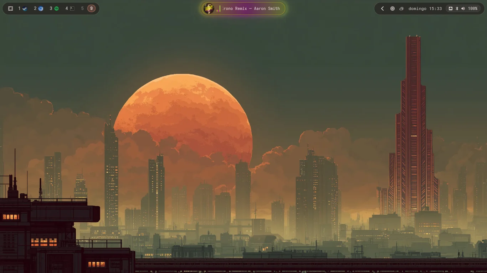

Recorrido completo, parte por parte: **[brunoaguinaga0.github.io/omarchy-afterglow](https://brunoaguinaga0.github.io/omarchy-afterglow/)** (en español e inglés).

## Cómo se ve

### Barra en islas

Escritorios con una pastilla animada e íconos de las apps a la izquierda, el reloj o el reproductor en el centro, y el estado a la derecha.

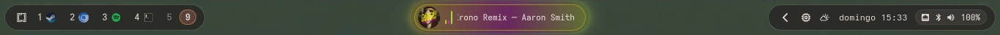

### Reproductor en la barra

Al pasar el mouse se abre el menú con la portada y los controles. El halo, el borde y los botones toman los colores de la portada y laten con la música (`cava`).

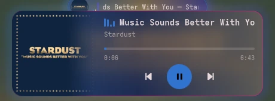

### Centro de control

Red, Bluetooth, no molestar, luz nocturna, micrófono, luces de música, volumen y micrófono.

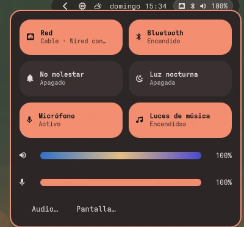

### Paneles de la barra

Los íconos de la isla derecha abren los paneles de Omarchy con el mismo vidrio que las islas, con los interruptores y la opción elegida en el color de acento.

| Audio | Red | Rendimiento |
|---|---|---|
| 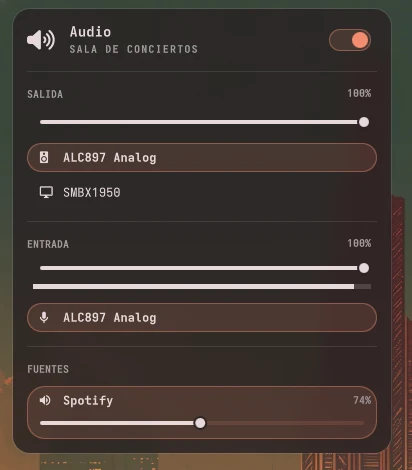 | 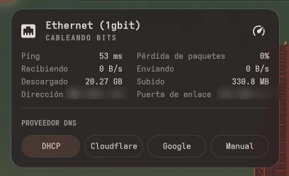 | 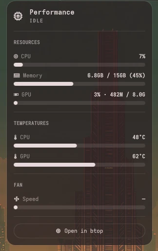 |
| **Bluetooth** | **Pantalla** | **Clima** |
| 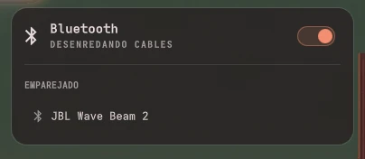 | 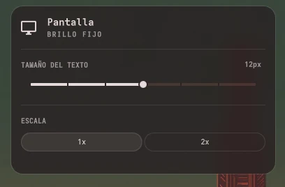 | 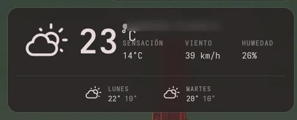 |

### Menú de Super + Espacio

Buscador con lupa, íconos en cuadraditos, separadores y ayuda de teclado. Todos los submenús de Omarchy salen con este diseño.

| Menú principal | Sistema |
|---|---|
| 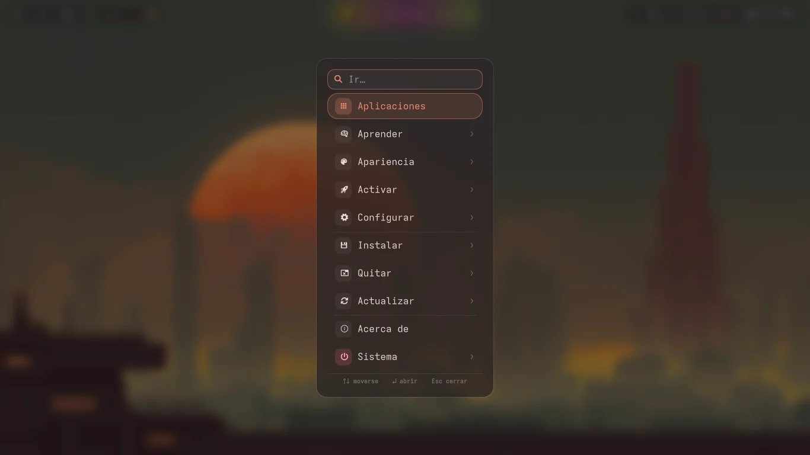 | 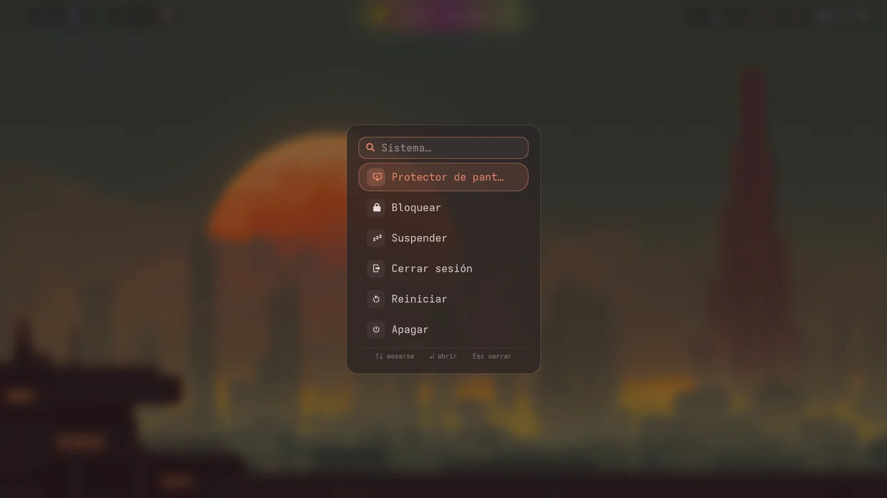 |

### Avisos de volumen y brillo

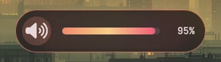

### Pantalla de bloqueo y protector

Tarjeta de música, aura alrededor de la pantalla que late con la música, clima y aviso "ahora suena". El protector muestra la portada grande con el aura, o un reloj si no suena nada.

| Bloqueo | Protector |
|---|---|
| 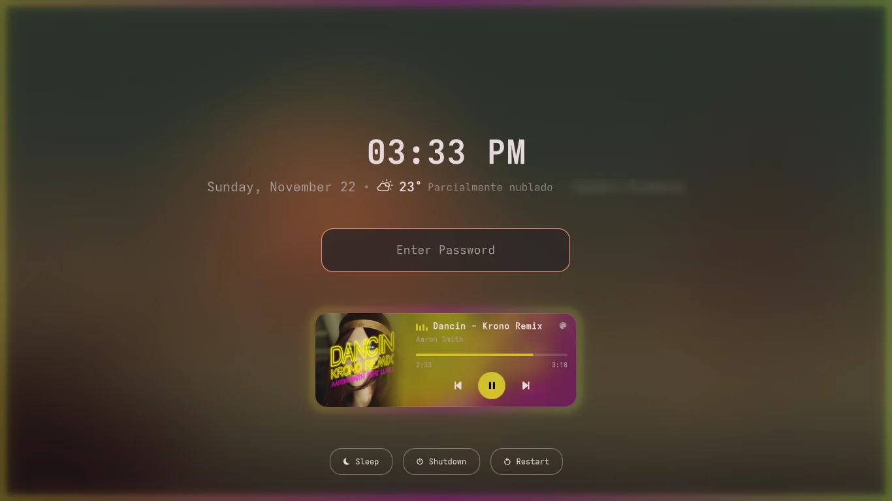 | 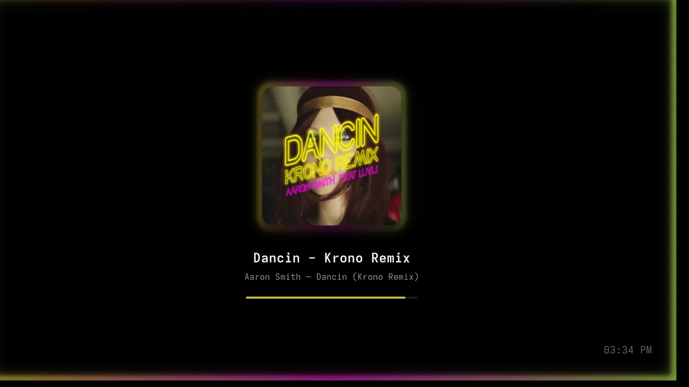 |

### Ventanas y terminal

Vidrio esmerilado, esquinas de 18 px, ventana inactiva atenuada, borde solo con dos o más ventanas y animaciones suaves. Terminal `foot` con márgenes amplios, prompt `starship` en píldoras y `fastfetch` compacto con logo propio.

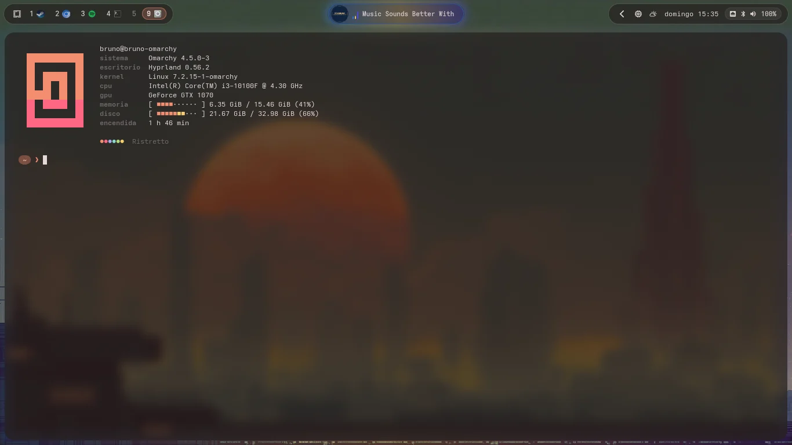

### También

- **Colores que siguen al tema:** al cambiar de tema, el hook `bruno-colors` recolorea el menú, las notificaciones, los paneles de la barra, el prompt y fastfetch.
- **Pantalla de arranque** Plymouth "bruno" (fondo desenfocado, tarjeta de vidrio, contraseña redondeada) y **cursor** Catppuccin Mocha Dark.

## Instalar

La forma más simple es pedirle a una IA con acceso a tu terminal (Claude Code, por ejemplo) que siga [`INSTRUCCIONES-IA.md`](INSTRUCCIONES-IA.md) (en inglés: [`INSTRUCTIONS-AI.md`](INSTRUCTIONS-AI.md)). La guía aplica solo lo visual: no toca tus monitores, atajos, dock ni tiempos de bloqueo, y guarda una copia `.bak` de todo lo que reemplaza. También se puede seguir a mano.

**Requisitos:** Omarchy 4.5 con Hyprland, `cava`, las fuentes Adwaita Mono y JetBrains Mono Nerd, y `sudo` para la pantalla de arranque y el cursor.

`bruno.bar`, `bruno.clock`, `bruno.menu`, `bruno.osd` y `bruno.workspaces` son copias modificadas de los plugins de Omarchy 4.5.0. Con una versión mucho más nueva, alguno puede no cargar.

## Qué hay en el repo

| Parte | Plugin o archivo | Origen |
|---|---|---|
| Barra en islas | `plugins/bruno.bar` | copia de `omarchy.bar` |
| Escritorios | `plugins/bruno.workspaces` | copia de `omarchy.workspaces` |
| Reloj que se corre con la música | `plugins/bruno.clock` | copia de `omarchy.clock` |
| Reproductor | `plugins/bruno.music` | propio |
| Centro de control | `plugins/bruno.control` | propio |
| Menú | `plugins/bruno.menu` | copia de `omarchy.menu` |
| Avisos de volumen y brillo | `plugins/bruno.osd` | copia de `omarchy.osd` |
| Bloqueo y protector | `plugins/bibek.lock` | [omarchy-better-lock](https://github.com/BibekBhusal0/omarchy-better-lock) de Bibek Bhusal (MIT), con cambios |
| Rendimiento en un ícono | `plugins/skyhonnor.performance` | [omarchy-performance](https://github.com/SkyHonnor/omarchy-performance) de SkyHonnor (MIT), opción `compact` |
| Orden de la barra y plugins activos | `config/omarchy/shell.json` | |
| Vidrio del menú, las notificaciones y los paneles de la barra | `config/omarchy/shell.toml` | |
| Opciones del bloqueo | `config/omarchy/lock.json` | |
| Espacios, animaciones, atenuado, bordes | `config/hypr/looknfeel.lua` | |
| Esquinas y cursor | final de `config/hypr/hyprland.lua` | |
| Terminal, prompt, fastfetch | `config/foot/foot.ini`, `config/starship.toml`, `config/fastfetch/` | |
| Colores que siguen al tema | `config/omarchy/hooks/theme-set.d/bruno-colors` | propio |
| Arranque y cursor | `config/omarchy/plymouth/` | propio |
| Vidrio, esquinas, protector de terminal apagado | `state/toggles/` | interruptores de Omarchy |

## Licencia

MIT, ver [`LICENSE`](LICENSE). Hay partes que vienen de Omarchy, omarchy-better-lock y omarchy-performance, también MIT; ver [`NOTICE.md`](NOTICE.md).

## Para mi propia compu

`sync.sh` y `restore.sh` son para mantener **mi** instalación completa, con mis preferencias personales incluidas. Si querés usar el diseño, seguí [`INSTRUCCIONES-IA.md`](INSTRUCCIONES-IA.md).

Guardar cambios:

```bash
./sync.sh
git status
git commit -am "..." && git push
```

Restaurar en otra compu mía:

```bash
gh repo clone BrunoAguinaga0/omarchy-afterglow
cd omarchy-afterglow
omarchy pkg add cava
./restore.sh
```

`restore.sh` copia los plugins y la config, deja los interruptores de Omarchy exactamente como en el repo, aplica el tema y el fondo (`state/theme`, `state/background`), enlaza el plugin de Superwhisper si la app está instalada y reinicia el shell. Todo lo que reemplaza queda antes en `*.bak.<fecha>`. El cursor y la pantalla de arranque se instalan aparte con `~/.config/omarchy/plymouth/install.sh` (pide sudo).
