# Omarchy Afterglow

*[Leer en español](README.es.md)*

An [Omarchy](https://omarchy.org) desktop that takes on the color and the beat of whatever you're listening to. The album cover tints the bar, the glow pulses with the bass, the lock screen is framed in an aura and the screensaver is the cover itself. Around it: a bar of glass islands, a redrawn menu, panels and on-screen notices, all following your theme's colors (Ristretto in the screenshots).

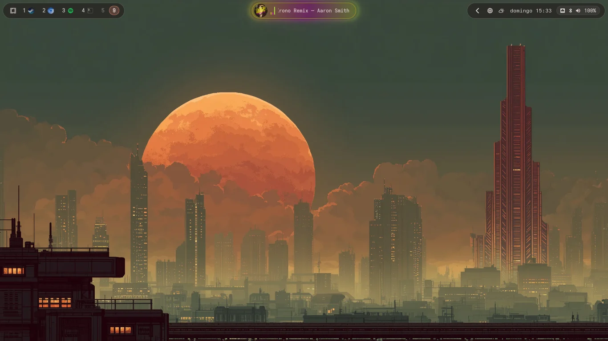

Full tour, part by part: **[brunoaguinaga0.github.io/omarchy-afterglow](https://brunoaguinaga0.github.io/omarchy-afterglow/)** (English and Spanish).

## What it looks like

The screenshots show Omarchy in Spanish; menus and labels follow your system language.

### Island bar

Workspaces with an animated pill and app icons on the left, the clock or the player in the middle, and status on the right.

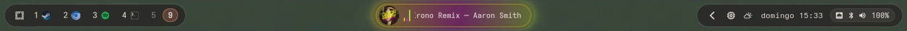

### Player in the bar

Hovering opens a menu with the cover and controls. The glow, border and buttons take the cover's colors and pulse with the music (`cava`).

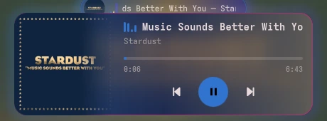

### Control center

Network, Bluetooth, do not disturb, night light, microphone, music lights, volume and microphone.

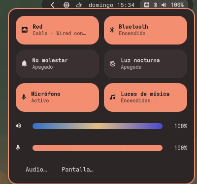

### Bar panels

The icons in the right island open Omarchy's panels in the same glass as the islands, with switches and the chosen option in the accent color.

| Audio | Network | Performance |
|---|---|---|
| 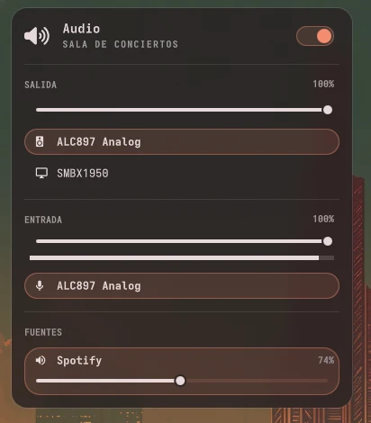 | 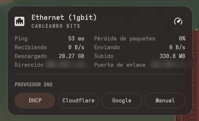 | 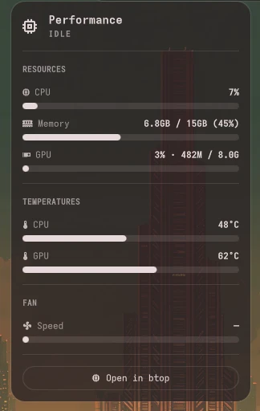 |
| **Bluetooth** | **Display** | **Weather** |
| 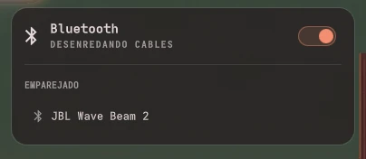 | 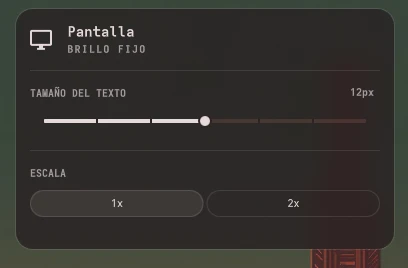 | 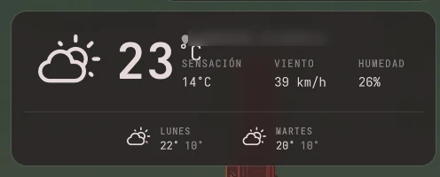 |

### Super + Space menu

Search field with a magnifier, icons in small squares, separators and a keyboard hint. Every Omarchy submenu gets this design.

| Main menu | System |
|---|---|
| 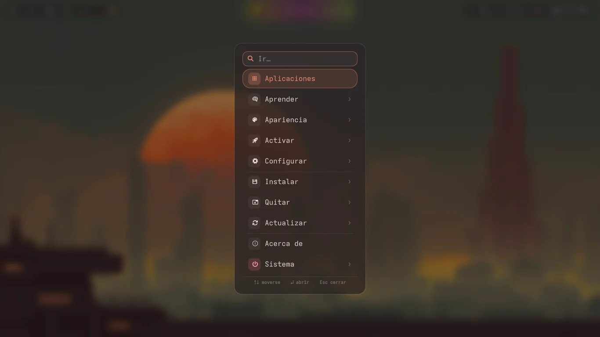 | 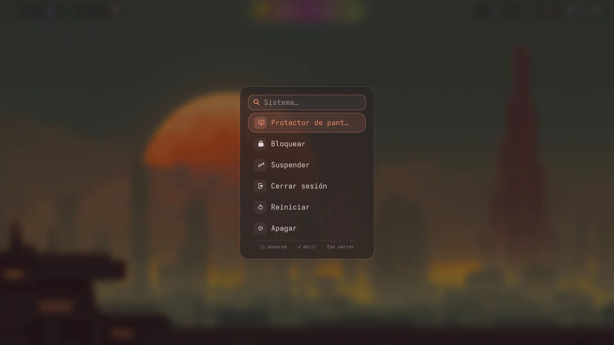 |

### Volume and brightness notices

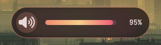

### Lock screen and screensaver

Music card, an aura around the screen that pulses with the music, weather and a "now playing" notice. The screensaver shows the cover large with the aura, or a clock when nothing is playing.

| Lock screen | Screensaver |
|---|---|
| 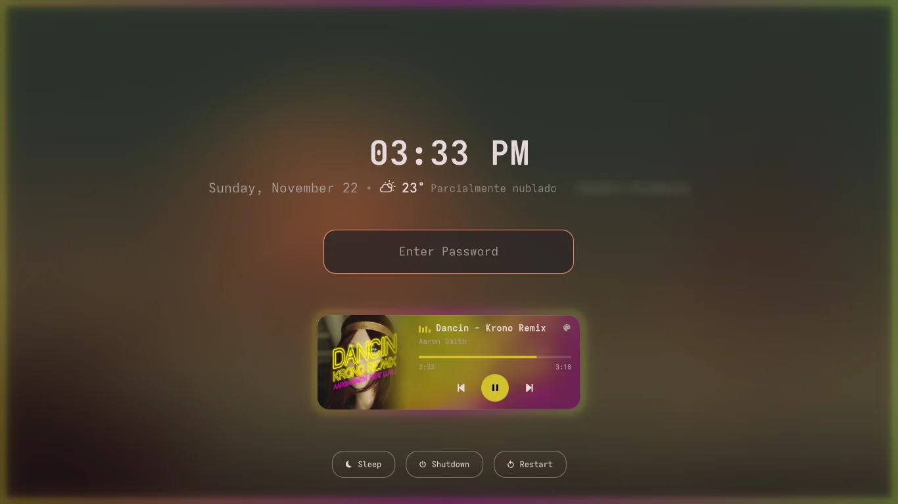 | 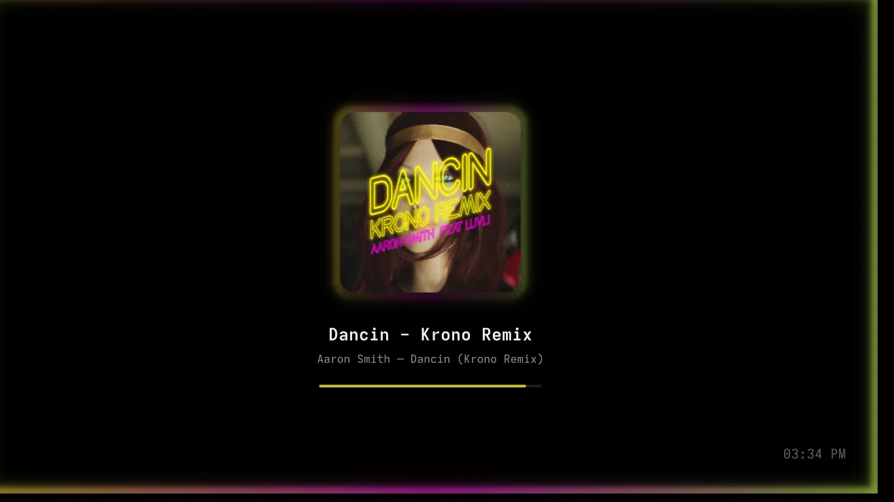 |

### Windows and terminal

Frosted glass, 18 px corners, dimmed inactive window, a border only with two or more windows, and smooth animations. `foot` terminal with wide padding, `starship` prompt in pills and a compact `fastfetch` with a custom logo.

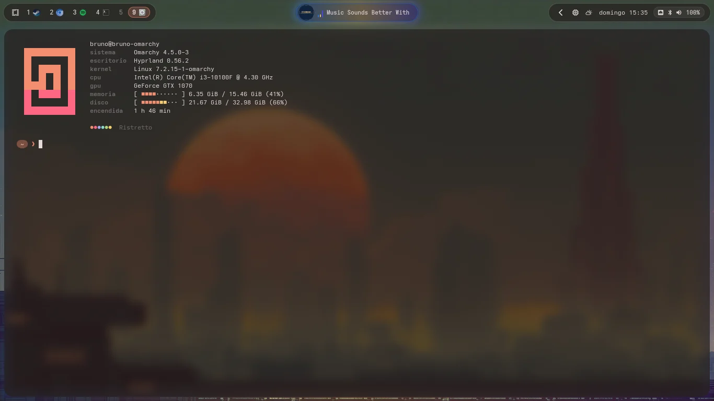

### Also

- **Colors that follow the theme:** when you switch themes, the `bruno-colors` hook recolors the menu, notifications, bar panels, prompt and fastfetch.
- Plymouth **boot screen** "bruno" (blurred wallpaper, glass card, rounded password field) and Catppuccin Mocha Dark **cursor**.

## Install

The easiest way is to ask an AI assistant with access to your terminal (Claude Code, for example) to follow [`INSTRUCTIONS-AI.md`](INSTRUCTIONS-AI.md). The guide applies only the visual parts: it leaves your monitors, keybindings, dock and lock timings alone, and keeps a `.bak` copy of everything it replaces. You can also follow it by hand.

**Requirements:** Omarchy 4.5 with Hyprland, `cava`, the Adwaita Mono and JetBrains Mono Nerd fonts, and `sudo` for the boot screen and cursor.

`bruno.bar`, `bruno.clock`, `bruno.menu`, `bruno.osd` and `bruno.workspaces` are modified copies of Omarchy 4.5.0's plugins. With a much newer version, some may fail to load.

## What's in the repo

| Part | Plugin or file | Origin |
|---|---|---|
| Island bar | `plugins/bruno.bar` | clone of `omarchy.bar` |
| Workspaces | `plugins/bruno.workspaces` | clone of `omarchy.workspaces` |
| Clock that moves aside for music | `plugins/bruno.clock` | clone of `omarchy.clock` |
| Player | `plugins/bruno.music` | original |
| Control center | `plugins/bruno.control` | original |
| Menu | `plugins/bruno.menu` | clone of `omarchy.menu` |
| Volume and brightness notices | `plugins/bruno.osd` | clone of `omarchy.osd` |
| Lock screen and screensaver | `plugins/bibek.lock` | [omarchy-better-lock](https://github.com/BibekBhusal0/omarchy-better-lock) by Bibek Bhusal (MIT), with changes |
| Performance in one icon | `plugins/skyhonnor.performance` | [omarchy-performance](https://github.com/SkyHonnor/omarchy-performance) by SkyHonnor (MIT), `compact` option |
| Bar layout and active plugins | `config/omarchy/shell.json` | |
| Menu, notification and bar panel glass | `config/omarchy/shell.toml` | |
| Lock screen options | `config/omarchy/lock.json` | |
| Gaps, animations, dimming, borders | `config/hypr/looknfeel.lua` | |
| Corners and cursor | end of `config/hypr/hyprland.lua` | |
| Terminal, prompt, fastfetch | `config/foot/foot.ini`, `config/starship.toml`, `config/fastfetch/` | |
| Colors that follow the theme | `config/omarchy/hooks/theme-set.d/bruno-colors` | original |
| Boot screen and cursor | `config/omarchy/plymouth/` | original |
| Glass, corners, terminal screensaver off | `state/toggles/` | Omarchy toggles |

## License

MIT, see [`LICENSE`](LICENSE). Parts come from Omarchy, omarchy-better-lock and omarchy-performance, also MIT; see [`NOTICE.md`](NOTICE.md).

## For my own computer

`sync.sh` and `restore.sh` keep **my** full setup, personal preferences included. If you want the design, follow [`INSTRUCTIONS-AI.md`](INSTRUCTIONS-AI.md) instead.

Save changes:

```bash
./sync.sh
git status
git commit -am "..." && git push
```

Restore on another computer of mine:

```bash
gh repo clone BrunoAguinaga0/omarchy-afterglow
cd omarchy-afterglow
omarchy pkg add cava
./restore.sh
```

`restore.sh` copies the plugins and config, mirrors Omarchy's toggles exactly as in the repo, applies the theme and wallpaper (`state/theme`, `state/background`), links the Superwhisper plugin if the app is installed and restarts the shell. Everything it replaces is first saved as `*.bak.<timestamp>`. The cursor and boot screen are installed separately with `~/.config/omarchy/plymouth/install.sh` (needs sudo).
