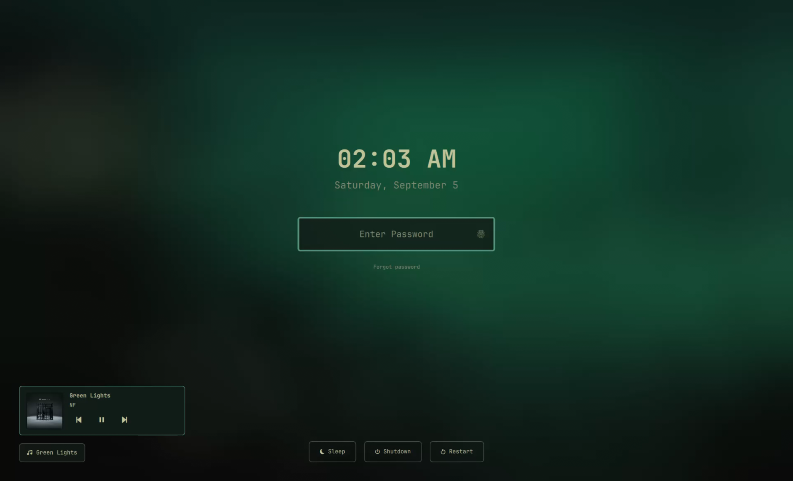

# Better Lock

A custom lock screen service for Omarchy, cloned from the built-in `omarchy.lock`.



## Features

From the built-in `omarchy.lock`:

- Password and fingerprint PAM authentication with session lock handling

New in this clone:

- Big customizable date and time display above the password input field
- Power action controls at the bottom for Shutdown, Restart, and Sleep
- Now-playing card between the password field and the power buttons: blurred cover backdrop, scrolling title/artist, equalizer, seekable progress and controls tinted from the cover art
- Music aura behind the card, coloured from the cover and reacting to the audio (cava); five styles, switchable from the palette button
- Weather next to the date (icon, temperature, condition and place), fetched only when the lock opens
- Screen stays lit while music is playing
- Music screensaver: the cover large with the aura around it (a clock without music), after `idle.screensaver` seconds; replaces Omarchy's terminal screensaver, so turn that one off with `omarchy toggle screensaver`
- "Now playing" pill under the bar whenever the track changes; click it to raise the player
- Separate password and fingerprint PAM authentication flows
- Full keyboard navigation across every control

## Requirements

- Omarchy quattro

## Install

This is a personal clone of the built-in `omarchy.lock`; on this machine it lives in the shell plugin monorepo and is installed under the id `bibek.lock`. To install from the standalone repo on a fresh system:

```bash
omarchy plugin add https://github.com/BibekBhusal0/omarchy-better-lock.git --enable
```

## Configuration

Options live in `~/.config/omarchy/lock.json` (watched live, so edits apply instantly):

```json
{
  "timeFormat": "hh:mm AP",
  "dateFormat": "dddd, MMMM d",
  "auraStyle": "horizon",
  "auraIntensity": 1,
  "screensaver": true,
  "nowPlaying": true
}
```

Try things without waiting: `omarchy-shell lock preview`, `omarchy-shell lock screensaver` (toggle), `omarchy-shell lock nowPlaying`, `omarchy-shell lock cycleAura`.

## Uninstall

```bash
omarchy plugin remove bibek.lock
```

## Credits

Lock screen service and layout adapted from the built-in `omarchy.lock` by the Omarchy team.

This plugin is licensed under the [MIT License](LICENSE).

## Others

Here are my other Omarchy plugins:

- [Focusd](https://github.com/BibekBhusal0/omarchy-focusd) - pomodoro timer with streak, history and daily goal
- [Better Media](https://github.com/BibekBhusal0/omarchy-better-media) - MPRIS now-playing with playback controls
- [Better Menu](https://github.com/BibekBhusal0/omarchy-better-menu) - fuzzy menu with app grid, calculator and web search
- [Obsidian Search](https://github.com/BibekBhusal0/omarchy-obsidian-search) - fuzzy-search your Obsidian vault
- [Readest](https://github.com/BibekBhusal0/omarchy-readest) - fuzzy-search your Readest library
- [Youtube Video Downloader](https://github.com/BibekBhusal0/omarchy-ytdl) - video downloads with progress and history

Please give a star if you find them useful!
